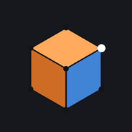

# PocketMesh



A polygon modeler for iPhone, built around the way Blender works: Object and Edit Mode, vertex / edge / face selection, extrude, inset, loop cut, Blender-style Move / Rotate / Scale with axis locks and typed values, UV unwrapping, image textures, and export to BRRES, OBJ, FBX, DAE and glTF.

It installs to your Home Screen and runs as a full-screen app. It works offline and keeps your scene on the phone.

## Install on iPhone

1. Open the app's address in **Safari**.
2. Tap **Share** (the square with an arrow), then **Add to Home Screen**, then **Add**.
3. Launch **PocketMesh** from the Home Screen.

There's no App Store, Mac or developer account involved. When a new version is published, the app picks it up the next time it is opened with a connection.

## What it does

| Area | Features |
| --- | --- |
| Shapes | Plane, Cube, Circle, UV Sphere, Ico Sphere, Cylinder, Cone, Torus, Grid. Each can be adjusted after adding (size, segments, rings, cap fill). |
| Selection | Object, vertex, edge and face modes. Multiselect button or long-press. Tap, box select, adjustable circle selection (drag to paint), edge loop (double-tap a surface edge in Edge mode), edge ring, linked, more/less, boundary loop, all/none/invert. Long-press to enter multiselect; tap to toggle, Done to finish. Set, Add or Subtract modes. X-ray to select through. |
| Transform | Move, Rotate, Scale and Shrink/Fatten. Drag anywhere, lock to X / Y / Z or a plane, tap twice for local axes, or type an exact value. Snap increments, proportional editing with six falloffs. Pivot: median, bounding box, individual origins, 3D cursor, active. Orientation: global, local, normal, view. Gizmo tools for direct handles. |
| Modeling | Extrude (region, individual, along normals), Inset (region / individual, depth), Loop Cut and Slide (multiple cuts), Subdivide, Fill, Grid Fill, Triangle Fill, Bridge Edge Loops, Merge (center, cursor, collapse, by distance), Delete and Dissolve, Duplicate, Separate, Join, Triangulate, Tris to Quads, Recalculate / Flip normals, Smooth / Flat shading, Mirror. |
| Face orientation | Subtle red backface overlay on by default; keeps front faces and textures unchanged. Toggle in Viewport Shading or Settings; the preference stays saved on this device. |
| Measure | Ruler with two-tap endpoints, vertex/edge snapping by default, meters by default, adjustable scale and display units, undo and saved measurements. |
| Track workspaces | Switch Model / KCL / KMP without replacing the scene or camera. Use the same camera controls and Move/Rotate/Scale tools (Move/Rotate for Start), identify materials by their image thumbnails, assign all 32 collision types and variants per material, mark Finish line as normal road, export KCL and a type-list CSV. Place/aim a KMP start on any visible model surface with automatic height; export automatic Time Trials test scaffolding or update an existing KMP while preserving its other sections. |
| SZS editor | Open a Yaz0/U8 track archive, browse/search every folder and file, replace from disk or inject current BRRES/KCL/KMP exports, revert replacements, and save/share a compressed SZS copy. Untouched file contents and paths are preserved. |
| BRRES editor | Open archives, list every model material with its texture links (including color-only materials), inspect resource/texture formats, preview all common Wii texture encodings, replace/resize/convert textures, regenerate mipmaps and save a copy. |
| Modifiers | Wrench panel with non-destructive Catmull–Clark / Simple subdivision (levels 0–3), face-based crease marking, Keep Corners / Keep All Boundary Edges, editable control mesh, Apply, undo and project persistence. |
| Objects | Origin to geometry or cursor, Apply location / rotation / scale, Separate by material / loose parts, Snap menu, Hide / Reveal, numeric transform panel, scene list. |
| UVs | Seams; Unwrap (conformal), Unwrap (minimum stretch), Smart UV Project, Lightmap Pack, Follow Active Quads, Cube / Cylinder / Sphere projection, Project From View, Reset. UV editor with **Straighten Grid**, Straighten, Straighten X/Y, Align X/Y/Auto, Align Rotation, Pack Islands, Average Island Scale, rotate (90° / 180°, and a Rotate tool that clicks to 0 / 90 / 180 / 270°), flip, weld, fit, stretch overlay, and UV layout PNG export. Pinch to zoom and twist to rotate the UV view. |
| Materials | Multiple material slots per object with per-face assignment. Base Color is a color (picker, palette, hex) or an image texture uploaded from Photos, the camera or Files, with optional color tint, Linear or Closest (pixel-art) filtering and Repeat / Extend edges. Generated UV-grid / checker textures. Image downscaling, MTL + image import, lit/unlit shaders, cutout/blend alpha and sidedness. Roughness, metallic, alpha. |
| Viewport | Wireframe, Solid, Material Preview and Rendered shading; face orientation overlay; navigation ball with one-tap front / side / top views; perspective / orthographic. |
| Files | Export Wii BRRES (static model + textures), OBJ+MTL, binary FBX 7.4 (textures embedded), COLLADA DAE, glTF 2.0 (.glb or .gltf). Import OBJ + MTL + images. Save and open `.pocketmesh.json` projects. Exports go through the iOS share sheet (Save to Files, AirDrop, other apps). |

See [Basic track authoring](TRACK-AUTHORING.md) for the BRRES/KCL/KMP workflow, format limits, validation and the additional course packaging needed for a playable Mario Kart Wii course.

## Gestures

- **Hold a vertex, edge, face or object**: enter multiselect; tap to toggle more; Done to finish.
- **One finger drag**: orbit. **Tap**: select. With **Circle Select**, drag paints a selection instead.
- **Two fingers**: drag to pan, pinch to zoom, twist to turn the view. **Two-finger tap**: undo. **Three-finger tap**: redo.
- **Map style** (Settings): one finger pans; two fingers pinch, twist and slide up/down to tilt, like a maps app.
- During Move / Rotate / Scale, drag anywhere on the viewport; two fingers still navigate.
- A hardware keyboard works too: Tab, G R S, X Y Z, E, I, Ctrl+R, A, F, M, U, Shift+A, Shift+D, Ctrl+Z, numpad views.

## Project layout

```
docs/            the built app (served by GitHub Pages)
src/             source modules, concatenated by build.mjs into docs/index.html
  DATA-FORMAT.md mesh and scene data format shared by the modules
  app_select.js  circle brush, add/remove strokes and selection history
  triangulate.js shared boundary-preserving, angle-improving triangulation
  mesh.js        mesh data structure, primitives, modeling operators
  uv.js          unwrapping, projections, packing, straightening
  extrude.js     Cursor extrusion and optional source/destination rotation
  modifiers.js   Catmull–Clark / Simple subdivision
  materials.js   basic MTL reader
  brres.js       static MDL0 + TEX0 BRRES writer
  brres_edit.js  archive inspector, texture decoder/encoder, preserving save
  measure.js     ruler units and measurement math
  export.js      OBJ / FBX / DAE / glTF writers, ZIP writer, OBJ reader
  app_*.js       viewport, transforms, operators, UV editor, files, interface
assets/icons/    Home Screen icons
test/            Node and headless-browser tests
build.mjs        build script
```

## Build and test

```bash
npm ci
```

```bash
npm run build
npm test
npx playwright install chromium
npm run test:track:browser
npm run test:editor:browser
npm run test:materials:browser
```

```bash
cd test && npm install && npm run test:export
```

`build.mjs` writes the app into `docs/`: one `index.html`, a vendored copy of three.js r160 (MIT, see `docs/vendor/THREE-LICENSE.txt`), the web app manifest, the offline service worker and icons. Serve `docs/` over HTTPS for the service worker and Home Screen install to work.

Track tools are grouped under **Track Editor → Course Model / KCL / KMP / SZS**.
Wii scene exports share a 100× default scale while the editor remains at modeling
size. In Edit Mode, **Extrude** offers **Tap extrude**, **Rotate to tap**, and
**Rotate source** controls; tap extrusion and tap rotation default off.

In split view, tapping a pane or its toolbar switches the shelf and controls to
that editor. UV tools have their own multiselect, G/R/S drag-tool shortcuts,
Home to fit, and visible operation settings. **3D View** returns from full-screen
UV. The 3D cursor uses a small, thin red-and-white ring with short crosshairs.
**Straighten X** makes selected UVs exactly horizontal; **Straighten Y** makes
them exactly vertical. Both keep spacing along that UV axis and leave unselected
UVs unchanged. Plain **Straighten** follows the direction between the endpoints.

Choose the dotted **Circle Select** icon in the left sidebar (keyboard: **C**,
also **Select → Circle Select**). Drag to paint vertices, edges, face centers or
whole objects. **Add** accumulates selection; **Remove** erases it. Set **Radius**
or use the **−/+** buttons; mouse wheel and keyboard **+/−** or **[/]** also resize
the brush. Middle mouse or Shift-drag temporarily removes. **Done**, Enter,
Escape or right-click finishes. Two fingers still navigate; Alt-drag or the
navigation buttons work with a mouse. Each stroke supports undo/redo. X-ray
controls whether the brush selects through surfaces.

Vertex taps and loose-edge taps stay individual even when repeated quickly.
Only double-tapping the same surface edge in Edge mode automatically selects a
loop; use **Select → Edge Loop…** for an entire wire chain. Loose wires and
isolated vertices remain visible and pickable in Object mode.

Select faces in **Edit Mode** and tap **Triangulate** on the bottom shelf
(also **Mesh → Triangulate Faces**, keyboard: **Ctrl+T**). Quads and convex or
concave n-gons become triangles while retaining their boundary vertices,
materials and UVs. Interior diagonals are improved to reduce skinny triangles
where possible. Rendering, UV unwrapping and triangle exports use this same
algorithm. Crossing or duplicate-corner outlines are left unchanged by the
modeling command, with a message to fix the outline. Undo restores the n-gons.

In **Edit Mode**, choose **Knife** in the left sidebar (keyboard: **K**). Tap a
face, vertex or edge to start, then another point to preview a cut across the
visible faces. Face interiors show a blue ring; edge snaps show lavender. Nearby vertices magnetize automatically and show a green ring.
Keep tapping to continue, or choose **New cut** for a separate stroke. **Done**
(Enter) commits the cuts as one undoable operation; **Cancel** (Escape) discards
them. **Undo cut** (Backspace) removes the last preview segment. Drag to orbit or
use two fingers to navigate. Materials, UV seams and creases survive the cuts.
Cuts can start and end inside faces, including n-gons. Interior endpoints add
supporting triangles so the cut is part of the surface. Hidden surfaces are
left untouched. **Knife Snap** starts enabled; turn it off for precise face
placement near a vertex or edge. Invisible supporting diagonals do not attract
the next cut. The purple **Done** button stays first in the knife controls.

Select faces and choose **Inset** in the left sidebar (keyboard: **I**, also in
**Mesh → Inset Faces**). Drag horizontally or type a thickness, then tap **Done**.
**Individual** insets each selected face separately; otherwise they inset as a
region. Convex and concave n-gons retain an inner n-gon, with texture coordinates
interpolated from the original surface. Single-face/individual insets stop before
the boundary overlaps. **Cancel** restores the mesh and selection; confirmed
insets support undo/redo and the existing depth adjustment.

The **Extrude** tool has **Quick drag** enabled by default: drag from a selected
vertex, edge, or face, and release to finish. The new geometry stays selected so
the next drag continues immediately. Drag empty space to navigate; two-finger
navigation cancels an unfinished quick extrusion. **Multiselect** and long-press
selection also work inside the tool. In vertex selection mode, **Vertices only**
extends each selected point with a wire edge, even when those points share an
existing edge or face. Otherwise, connected selections extrude as a region.
For precise steps, use **Drag extrude** and its axis/value controls, then **Next**
(or **E**) to commit and immediately extrude again. **Done** finishes; **Cancel**
removes the current unconfirmed step. Tap extrusion remains optional and off by
default; **Vertices only** works with tap extrusion too.
